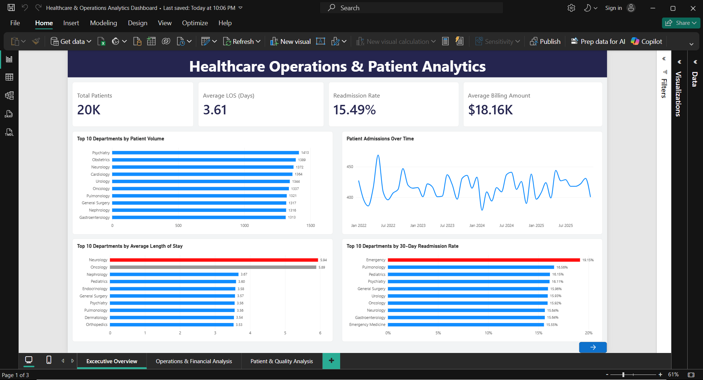
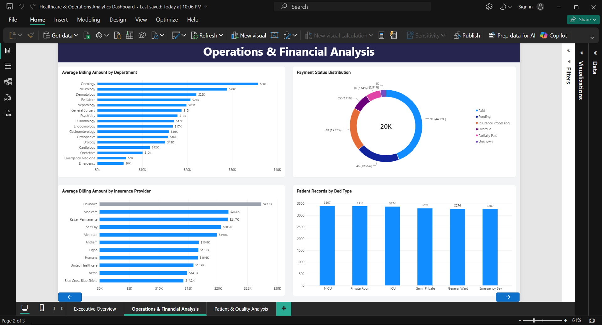
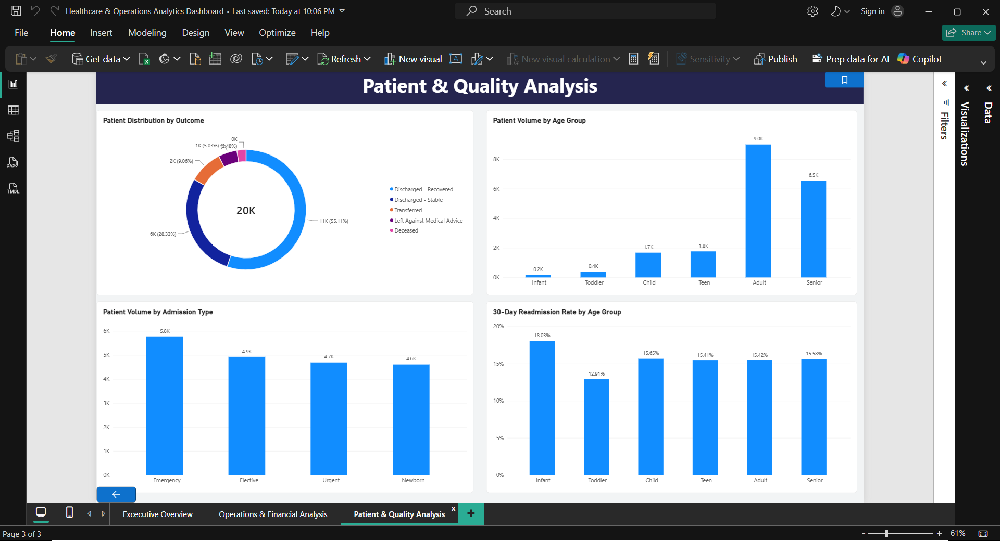

# Healthcare Operations & Patient Analytics

## Project Overview

Analyzed a **synthetic healthcare dataset of 20,000 patient records** to evaluate patient volume, length of stay, 30-day readmissions, billing patterns, and hospital department performance.

This project demonstrates an end-to-end Data Analyst workflow using **Excel for data cleaning, SQL for analysis, Python for database setup, and Power BI for dashboard development and KPI reporting**.

> **Note:** This dataset is synthetic and intended for portfolio and educational purposes. Findings should not be interpreted as actual hospital or clinical performance.

## Business Questions

- Which departments have the highest patient volume?
- How does average length of stay vary across departments?
- How does patient admission volume change over time?
- What is the overall 30-day readmission rate, and how does it vary by department?
- How do billing amounts vary across departments and insurance providers?
- How do patient outcomes, admission types, and readmissions vary across patient groups?

## Tools & Technologies

- **Excel** — Data cleaning, validation, standardization, and data preparation
- **SQL (SQLite)** — Data analysis, aggregations, and KPI calculations
- **Python (Pandas, SQLite3)** — Database creation and data loading
- **Power BI / DAX** — Data modeling, KPI measures, visualization, and dashboard development

## Data Preparation

The original dataset contained **20,400 records** and required cleaning before analysis. Key steps included:

- Removed duplicate records and validated **20,000 unique patient records**
- Removed unnecessary patient-identifying information
- Standardized inconsistent categorical values across departments, diagnoses, insurance providers, payment statuses, and other fields
- Identified invalid ages and handled missing values based on data type and analytical context
- Reconstructed inconsistent discharge dates using admission date and length of stay, followed by validation
- Reviewed potential billing outliers without modifying values where there was insufficient evidence of data error

The original raw dataset was preserved separately from the cleaned analytical dataset.

## SQL Analysis

The cleaned dataset was loaded into **SQLite** using Python. SQL was used to analyze:

- Total patient volume
- Patient volume by department
- Average length of stay
- Department-level length of stay
- Readmission rates
- Admission trends
- Billing and operational performance

SQL queries are available in [`hospital_analytics.ipynb`](Healthcare Analytics/hospital_analytics.ipynb).

## Power BI Dashboard

The Power BI report contains three analytical pages:

**1. Executive Overview**  
Provides high-level KPIs and trends for patient volume, average length of stay, readmissions, billing, and department performance.

**2. Operations & Financial Analysis**  
Analyzes billing by department and insurance provider, payment status, and bed utilization.

**3. Patient & Quality Analysis**  
Analyzes patient outcomes, age groups, admission types, and 30-day readmission patterns.

### Key KPIs

| KPI | Result |
|---|---:|
| Total Patients | 20,000 |
| Average Length of Stay | 3.61 days |
| 30-Day Readmission Rate | 15.49% |
| Average Billing Amount | $18.16K |

## Key Insights

- **Psychiatry**department  recorded the highest patient volume with **1,413 patients** followed by **Obstetrics** department with  **1389**.
- **Neurology** and **Oncology** had the longest average stays at **5.94** and **5.89 days**, respectively.
- The overall **30-day readmission rate was 15.49%** among patients with known readmission status.
- Patient volume and operational metrics varied across departments, highlighting differences in utilization and length-of-stay patterns.

## Repository Structure

```text
Healthcare-Operational-Analytics/
├── Dashboard/       # Power BI dashboard
├── Data/            # Raw and cleaned datasets
├── Healthcare Analytics/             # SQL analysis queries
├── README.md
└── .gitignore
```

## Dashboard Preview

Dashboard screenshots will be displayed here to provide a quick overview of the final Power BI report.
 Exceutive Dashboard
 

Operational & Financial Analysis


Patient & Quality Analysis
